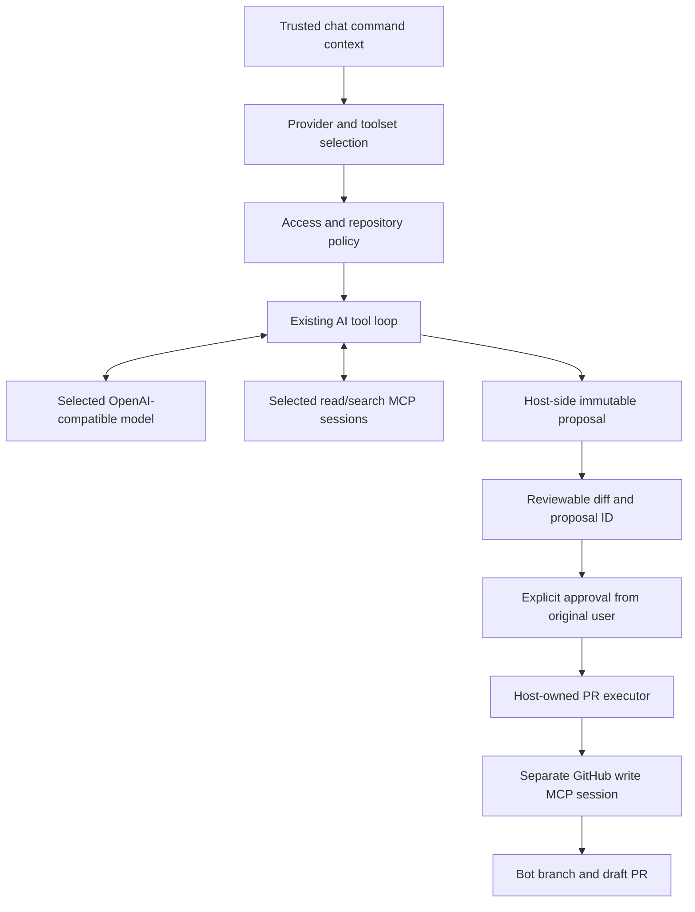
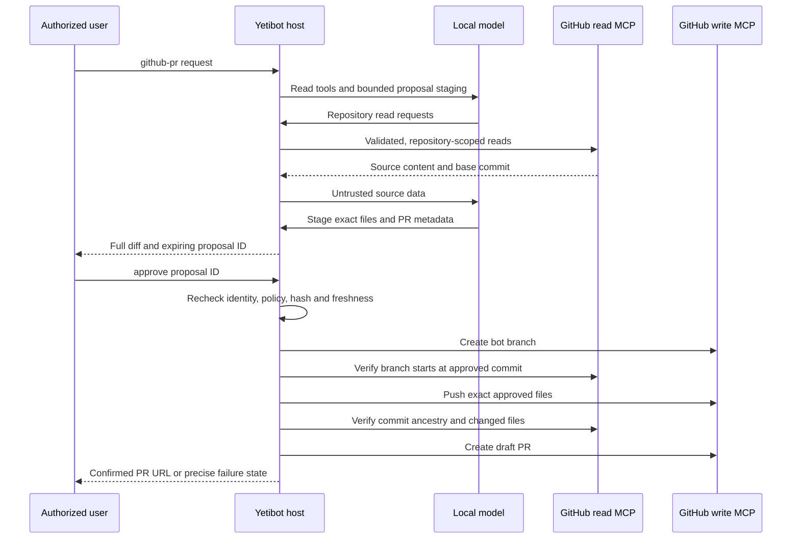
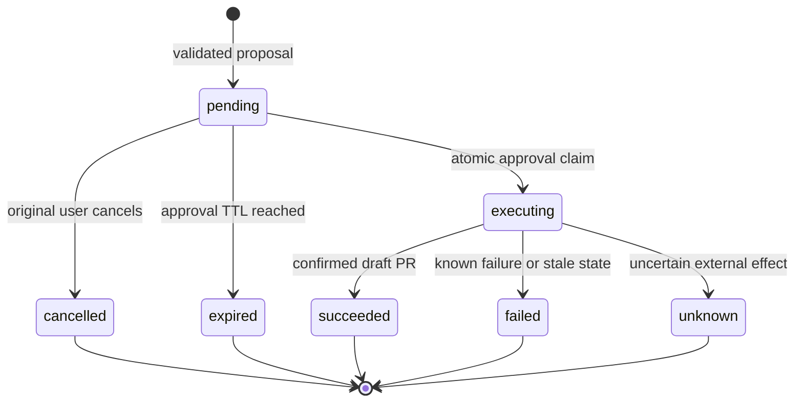

# Configurable AI GitHub and Search Tools - Plan

## Goal Capsule

- **Objective:** Configure reusable MCP toolsets for web search and GitHub, including reviewed code changes and draft PRs generated by local OpenAI-compatible models.
- **Authority:** The user's confirmed scope includes guarded PR creation, not only read access. Preserve the existing Gemini-backed `code` workflow separately.
- **Baseline:** After the user's pull, this checkout is `master` at `454eba0`. Named providers and thread context are present; MCP commit `e43e48b` is still on `origin/feat/ai-mcp-tools`. Recheck at implementation start and incorporate that prerequisite only if missing.
- **Boundary:** Extend the existing MCP client and tool loop; do not implement another transport or coding CLI integration.
- **Stop conditions:** Unknown write outcomes, changed approved content, stale repository state, missing identity, or denied policy stop execution without automatic mutation retries.
- **Delivery:** Ship configuration/read/search support before enabling writes. Implementation includes tests and operator documentation, not automatically deploying or modifying production repositories.

---

## Product Contract

### Summary

Add administrator-configured toolsets to `ai`, with initial recipes for web search, GitHub inspection, and proposing small code changes that become draft PRs after explicit approval.
Use the selected local OpenAI-compatible provider for generation and MCP servers for external actions.

### Problem Frame

The existing Gemini `code` workflow clones a repository, delegates editing to Gemini CLI, then commits, pushes, and creates a PR.
The newer `ai` command already selects named OpenAI-compatible providers and supplies thread context.
The MCP extension already supplies configurable servers and a bounded tool loop, but exposes every configured tool to everyone who can run `ai`.
Connecting GitHub mutation tools directly would therefore grant shared service-account write access without a review boundary.

### Requirements

**Configuration and inference**

- R1. Configure named toolsets through Yetibot's existing EDN/environment configuration, referencing explicit server/tool allowlists.
- R2. Select a toolset per request, with administrator defaults and provider/model restrictions; retain `--no-tools`.
- R3. Support local OpenAI-compatible Chat Completions function calling without Gemini CLI, cloud-model fallback, or native OpenAI Responses API dependencies.

**External capabilities**

- R4. Search the web through a configurable MCP search server and return source URLs without claiming a failed search succeeded.
- R5. Read allowlisted GitHub repositories, files, issues, PRs, and commit state through the official GitHub MCP server.
- R6. Generate bounded text-file changes and a reviewable diff before performing any GitHub mutation.
- R7. After approval, create a bot-owned branch, commit exactly the approved files, and open a draft PR through MCP.

**Safety and compatibility**

- R8. Restrict private-repository reads and PR creation using trusted adapter/user/conversation identifiers and repository policy, not model text or display names.
- R9. Bind approval to the requesting user, conversation, repository, base commit, provider/model, exact changes, and PR metadata; reject stale, changed, replayed, or cross-context approvals.
- R10. Preserve bounded calls, credential redaction, isolated server environments, session cleanup, and no automatic replay after uncertain external effects.
- R11. Keep plain AI, existing search configurations, legacy `openai`, and the Gemini `code` command working independently.

### Key Flows and Acceptance Examples

- F1. A user selects `search`; only that toolset's server connects, the local model calls search, and the answer includes returned source URLs.
- F2. An authorized user selects `github-read`; the model inspects an allowed repository but cannot mutate it or read another repository through a broader search query.
- F3. An authorized user selects `github-pr`; reads and local proposal staging produce an immutable proposal and diff. The same user approves it in the same conversation; the host executes MCP writes and returns the draft PR URL.
- AE1. With search and GitHub configured, a search-only request succeeds while GitHub is unavailable because GitHub is not connected.
- AE2. A repository file or web result instructing the bot to push code cannot authorize a write; the ordinary model loop has no raw mutation tools.
- AE3. A second user, another thread, an expired proposal, or a second approval produces no GitHub writes.
- AE4. A timeout after pushing files stops PR execution and reports the known branch and uncertain step, without claiming success or replaying the push.
- AE5. No configured MCP server, or `--no-tools`, preserves the existing provider-only request path.

### Scope Boundaries

- Configuration is administrator-owned and loaded at startup. Chat can select, inspect, approve, or cancel; it cannot edit credentials, server executables, or access policy.
- Initial PRs cover small text-file additions/updates. No deletes, binary files, symlinks, submodules, repository administration, merges, releases, or direct default-branch writes.
- No shell execution or local checkout in this workflow. PR descriptions state that generated changes have not been locally tested; repository CI and human review remain required.
- No automatic discovery of arbitrary servers, interactive OAuth, per-user GitHub login, or migration of the existing Gemini command.

#### Deferred to Follow-Up Work

- Sandboxed checkout/build/test execution for larger coding tasks.
- Durable multi-instance proposal storage and resumable write jobs.
- In-chat configuration editing, GitHub App token minting, and additional MCP integrations.

---

## Planning Contract

### Existing Foundations

The following MCP paths exist in prerequisite commit `e43e48b`, not in the inspected `master` snapshot:

- `src/yetibot/api/mcp.clj`: MCP Java SDK client, stdio/Streamable HTTP, explicit tool allowlists, redaction, per-request sessions, cleanup, and uncertain-outcome handling.
- `src/yetibot/models/ai_tools.clj`: OpenAI function schemas, call-ID routing, whole-batch validation, duplicate-action detection, and tool-call budgets.
- `src/yetibot/commands/ai.clj`: `servers`, `tools`, and `--no-tools` additions.
- `test/fixtures/mcp_server.py` and `test/yetibot/test/support/mcp.clj`: reusable real-transport fixtures.
- `project.clj`: MCP SDK `2.1.0` and Jackson annotations compatibility pin; keep these prerequisite dependency changes rather than independently upgrading the stack.

Already present on updated `master`: `src/yetibot/api/ai.clj`, `src/yetibot/models/ai_context.clj`, corresponding Midje tests, and `doc/AI.md`.
Historical Gemini behavior is documented by commit `6006c4f` and its former `src/yetibot/commands/code.clj`; that command later moved to the core dependency.
It is a behavior reference, not code to copy or a new dependency to invoke.

### Key Technical Decisions

- KTD1. **Separate connections, toolsets, and policy.** Keep `ai.mcp.servers` for trusted connection details. Add named toolsets referencing server/tool pairs, defaults, allowed providers/models, and access rules. Selecting a toolset narrows the server allowlist; it never expands it.
- KTD2. **Offer three initial recipes, not hardcoded providers.** `search` references an operator-selected search server; `github-read` references the official GitHub read server; `github-pr` adds host-side proposal staging to GitHub reads. Future search providers still require configuration rather than new command code.
- KTD3. **Keep mutation credentials out of model-driven discovery.** Use separate GitHub read/write server configurations and least-privilege, repository-scoped credentials. Open the write connection only after approval. Raw GitHub mutations are rejected from model-facing toolsets, including legacy configurations; unknown tools are never presumed safe based on MCP annotations.
- KTD4. **Use the official GitHub MCP server.** Prefer a pinned local stdio executable for a reproducible deployment, with PAT authentication supplied explicitly to its environment. Document hosted Streamable HTTP as an alternative using an exact endpoint and Authorization header. Server-side read-only mode complements, but does not replace, host policy. Use fine-grained tokens limited to selected repositories: read Contents/Issues/Pull requests as needed, and grant only Contents/Pull requests write permissions to the writer. Credential rotation is an operator-owned config update and restart.
- KTD5. **Make compatibility explicit.** Allow a provider's tool calling to be enabled/disabled and its `tool_choice` emission to use the standard contract or an explicitly configured omission mode. Validate model overrides against the selected toolset. Enforce budgets and write policy locally even when a server ignores `tool_choice`; do not translate prose or XML into executable tool calls.
- KTD6. **Approve an immutable proposal, not an open-ended agent run.** A host-side staging tool accepts bounded changes but has no external write capability. Approval executes a deterministic host-owned MCP sequence; it never resumes the model with mutation tools. Any change to content or metadata requires a new proposal and approval.
- KTD7. **Use bounded, ephemeral proposal state initially.** Store proposals in a process-local atom with atomic transitions, a ten-minute approval TTL, a maximum of 128 active proposals, and cleanup. Restart invalidates pending approval IDs. Support a single Yetibot executor instance; do not claim distributed replay protection.
- KTD8. **Keep GitHub PR context private to configured inference endpoints.** The `github-pr` toolset requires an explicit provider/model allowlist containing the intended local endpoints. Do not infer locality from provider names, and never fall back to a cloud model. Search and GitHub services still receive tool arguments over the network.

### Configuration Contract

- `ai.mcp.servers` remains the connection registry with explicit allowed tool names.
- Named toolsets contain a name, server/tool references, provider/model constraints, and adapter/user/conversation access rules. GitHub toolsets also carry repository allowlists; PR policy adds base branches, branch prefix, allowed/denied paths, file/byte bounds, and the write-server reference.
- Validate references, unique names, nonempty effective tools, safe defaults, and contradictory settings before connecting to a server. Environment values must normalize strings/booleans consistently with existing numeric MCP settings.
- Preserve legacy flat search configuration when named toolsets are absent. GitHub write tools must use the guarded workflow rather than becoming a legacy bypass.
- Prohibit `--toolset` with `--no-tools` rather than guessing intent. An omitted toolset uses the configured default; without named toolsets, retain the legacy read/search path.
- Initial proposal bounds: at most five files and 8 KiB of combined UTF-8 content, with final encoded tool arguments also checked against the existing 16,384-character limit. Reject oversize input, never silently truncate approved files or diffs.
- Do not assume shell-style `${ENV}` interpolation exists in EDN. Use actual Yetibot environment configuration or operator-generated private config; documentation must not suggest Pi/VS Code config syntax is supported here.

### High-Level Technical Design

Terminal states cannot be re-approved.
Retain bounded terminal metadata long enough to report replay/uncertainty during the TTL; never retain source content in ordinary logs.
Emit sanitized audit events containing actor/conversation IDs, repository, manifest hash, provider/model, state transition, and known branch/commit/PR identifiers, but not prompts, source bytes, tokens, or raw MCP payloads.

### GitHub and Search Boundaries

- Suggested read tools: `get_file_contents`, `get_commit`, `list_branches`, `issue_read`, `pull_request_read`, and only repository-scoped search operations that the host can constrain. Confirm exact names and schemas with `tools/list` for the pinned server version.
- Host-only write operations: `create_branch`, `push_files`, and `create_pull_request` with `draft` forced true. Exclude `merge_pull_request`, repository deletion, arbitrary ref updates, and workflow administration.
- GitHub searches must be scoped structurally to allowed repositories; validate owner/repo arguments and every operation selector. Disallow any tool whose schema cannot be constrained safely. Do not rely on a prompt saying which repository to use.
- Path policy rejects traversal, absolute paths, duplicate normalized paths, `.git`, secrets, and sensitive automation paths such as `.github/workflows` by default. Never modify symlinks or submodules through text-file operations.
- Fetch source at a recorded commit, not an evolving branch name. Approval checks the configured base branch is still at that commit. Because `create_branch` exposes `from_branch`, verify the created branch SHA before pushing; if the branch raced, leave it untouched and report the empty branch.
- Use an unpredictable bot branch name and reject collisions. After pushing, verify the resulting parent commit and changed-file content match the approved manifest before opening the PR. Drift stops execution; do not force-push or attempt an automatic rollback.
- Search uses the existing Exa/Tavily/SearXNG-adapter configuration patterns. Select and pin one deployment recipe during setup; do not require all search services. A plain SearXNG HTTP endpoint is not an MCP server.
- The ordinary read loop retains the current global tool budget. The host PR executor has a fixed, independently bounded sequence and the same timeout/no-retry guarantees; approval does not reset an unbounded model loop.

### Operational Risks and Impact

- Shared service credentials do not represent the chat user. Restrict private GitHub reads as well as writes, and require approved output conversations; private content must not be posted to arbitrary public channels.
- Repository content, MCP descriptions, search results, and thread messages are untrusted input. Policy uses trusted command context and server configuration, never identity claims inside model messages.
- Draft PRs can trigger CI. Deny workflow-file edits initially, use repository-scoped token permissions, and retain normal review/branch protections. Confirm the target repository's CI policy is safe for bot-generated code before enabling writes; denying workflow edits alone does not make test/build execution safe. No auto-merge or CI-success claims.
- A write timeout may leave a branch, commit, or PR behind. Record known identifiers before proceeding and report an unknown result for operator inspection; never retry a mutating operation automatically.
- A provider accepting `/models` is not proof of tool calling. Ollama/vLLM/llama.cpp/LM Studio compatibility is version/model/template-specific; verify deployed combinations rather than promising universal support.
- Configuration remains in Yetibot, not the separately versioned core library. Existing command access controls are defense in depth; implement request-level policy here rather than requiring a core-wide authorization redesign.

### Deferred Implementation Questions

- The deployment's exact local server, model ID, search service, GitHub credential, and repository/user IDs are setup inputs, not architecture blockers. Do not solicit or commit secret values.
- Verify the pinned GitHub server's result shapes and binary/base64/large-file behavior before enabling the PR workflow. Reject unsupported or incomplete source reads instead of generating replacements from truncated content.
- Confirm adapter identity fields against the installed core version. Initially allow writes only on adapters with stable user and conversation identifiers; fail closed elsewhere.

---

## Implementation Units

### U1. Reuse MCP foundation and add named toolset configuration

**Goal:** Build on the existing MCP commit and resolve a safe, narrowed toolset before connecting.
**Requirements:** R1, R2, R10, R11; AE1, AE5.
**Dependencies:** Existing MCP commit `e43e48b`, if not already integrated.
**Files:** `project.clj` only for the prerequisite dependencies; modify `src/yetibot/api/mcp.clj`, `src/yetibot/models/ai_tools.clj`; add `src/yetibot/models/ai_toolsets.clj`, `test/yetibot/test/models/ai_toolsets.clj`; extend `test/yetibot/test/api/mcp.clj` and `test/yetibot/test/models/ai_tools.clj`.
**Approach:** Normalize/validate toolsets, default selection, and references; pass a filtered MCP config into the existing session manager. Keep host-managed writes separate from model-facing entries.
**Patterns:** Existing `clojure.spec` validation, numeric environment normalization, sanitized configuration errors, and `mcp/with-tools` cleanup.
**Test scenarios:**
1. A named search toolset connects only its referenced server while an unselected GitHub server fails.
2. Duplicate names, missing tools/servers, out-of-allowlist references, invalid defaults, and contradictory flags fail before any connection.
3. Flat search config and no-MCP config retain existing request behavior; raw GitHub write entries cannot bypass guarded execution.
4. EDN and equivalent environment-shaped configuration normalize to the same effective policy without exposing credentials in errors.
**Verification:** Selected tool definitions and connections match exactly; existing MCP regression coverage remains intact.

### U2. Harden local OpenAI-compatible function calling

**Goal:** Support explicit endpoint/model capabilities without weakening host-side limits.
**Requirements:** R2, R3, R10, R11.
**Dependencies:** U1.
**Files:** Modify `src/yetibot/api/ai.clj`, `src/yetibot/models/ai_tools.clj`; extend `test/yetibot/test/api/ai.clj`, `test/yetibot/test/models/ai_tools.clj`.
**Approach:** Add validated provider capability options and toolset provider/model restrictions. Retain standard function-call messages and call-ID matching; configurable omission of `tool_choice` is a compatibility mode, not a permission decision.
**Patterns:** Existing provider request shaping and no-redirect/no-retry HTTP behavior.
**Test scenarios:**
1. A local stub completes a multi-turn function-call/result exchange with the original call IDs.
2. Disabled tool support is rejected before MCP discovery; plain prompts and `--no-tools` still work.
3. An unapproved model override or cloud provider cannot use `github-pr`.
4. Standard and omission modes produce the configured wire shape; a server that requests calls after the budget still causes zero extra executions.
5. Invalid JSON, duplicate actions, missing call IDs, prose-only pseudo-calls, and unsupported schemas do not execute tools.
**Verification:** Endpoint quirks cannot grant tools, trigger a cloud fallback, or bypass the call budget.

### U3. Enforce GitHub read and search policy

**Goal:** Make the first two integrations usable with credential and repository boundaries enforced outside the model.
**Requirements:** R4, R5, R8, R10; F1, F2, AE1, AE2.
**Dependencies:** U1, U2.
**Files:** Add `src/yetibot/models/ai_tool_policy.clj`, `test/yetibot/test/models/ai_tool_policy.clj`; modify `src/yetibot/models/ai_tools.clj`; extend `test/yetibot/test/models/ai_tools.clj`, `test/fixtures/mcp_server.py`, `test/yetibot/test/support/mcp.clj`.
**Approach:** Thread trusted execution context separately from model messages; authorize before discovery and validate the complete call batch before effects. Add domain-specific repository/search argument constraints without hardcoding a particular web-search vendor.
**Patterns:** Existing whole-batch validation and final-layer MCP allowlist checks.
**Test scenarios:**
1. Allowed user/conversation/repository reads succeed; missing identity, another repository, and a broad search query fail before external calls.
2. Mixed authorized/unauthorized call batches execute nothing.
3. Search returns source URLs; a failed search produces a limitation rather than a fabricated successful-search marker.
4. Injected instructions in files/results cannot alter actor, selected provider, policy, or toolset.
5. Read-only metadata and error messages omit credentials and do not reveal inaccessible repositories or server descriptions.
**Verification:** Both mocked and fixture-backed calls prove that policy is enforced at execution, not merely in model instructions.

### U4. Stage and approve immutable change proposals

**Goal:** Allow local-model change generation without granting GitHub mutation access.
**Requirements:** R6, R8, R9, R10; F3, AE2, AE3.
**Dependencies:** U2, U3.
**Files:** Add `src/yetibot/models/ai_proposals.clj`, `test/yetibot/test/models/ai_proposals.clj`; modify `src/yetibot/models/ai_tools.clj`; extend `test/yetibot/test/models/ai_tools.clj`.
**Approach:** Expose a host-side staging tool only for authorized `github-pr` requests. Validate exact source reads, paths, bytes, and PR metadata; generate the diff from trusted source bytes. Store an immutable manifest, hash, identities, base commit, and expiration. Atomically claim a valid proposal before executing.
**Execution note:** Write approval and race tests before connecting this state to real mutations.
**Patterns:** Existing pure validators and bounded in-memory model state; no new database dependency.
**Test scenarios:**
1. A valid small change produces a complete inspectable diff and performs zero GitHub writes.
2. No-op changes, incomplete/truncated source reads, traversal, denied paths, binaries, duplicate paths, and boundary-limit overflows are rejected.
3. Another user/thread, a bot or edited approval message, altered manifest, expiry, cancellation, and restart-invalid IDs cannot execute.
4. Concurrent/repeated approvals permit one state transition to executing; all other attempts observe a non-pending state.
5. Capacity/TTL cleanup is bounded, and private file content is not written to normal logs.
**Verification:** Approval authorizes one immutable manifest once; it cannot authorize future model-selected actions.

### U5. Execute approved draft PRs through GitHub MCP

**Goal:** Replace Gemini's role for this new workflow with deterministic MCP branch/commit/PR execution.
**Requirements:** R7, R8, R9, R10; F3, AE4.
**Dependencies:** U3, U4.
**Files:** Add `src/yetibot/models/ai_github.clj`, `test/yetibot/test/models/ai_github.clj`; extend `test/fixtures/mcp_server.py`, `test/yetibot/test/support/mcp.clj`, `test/yetibot/test/api/mcp.clj`.
**Approach:** Revalidate policy and base state, open only the approved write server, create a fresh bot branch, verify its SHA, push approved files, verify resulting content/ancestry, and create a draft PR. Never forward raw writer output or credentials into the model transcript.
**Patterns:** Existing `mcp/call-tool` unknown-outcome handling and per-request session cleanup; keep this separate from the ordinary model loop.
**Test scenarios:**
1. The fixture observes only the approved owner/repo, generated branch, exact file contents, approved PR metadata, and forced `draft=true`.
2. Stale base, branch collision, branch-creation race, forbidden destination, and changed server schema stop before the next mutation.
3. Known push errors and unknown create/push/PR outcomes stop the sequence without retries; known branch/commit identifiers survive in sanitized user-visible status.
4. Unexpected post-push ancestry/content prevents PR creation and never triggers a force push or unapproved cleanup.
5. Every success/failure closes sessions; returned URLs must come from confirmed GitHub results, not model text. Audit events include state and identifiers without source content or credentials.
**Verification:** A real MCP fixture proves the sequence and failure cutoffs; an operator-approved disposable-repository smoke test proves a draft PR, not just mocked API calls.

### U6. Expose toolset selection, proposal review, and approval in chat

**Goal:** Make configuration and guarded PR workflows discoverable from the existing `ai` command.
**Requirements:** R1, R2, R6, R8, R9, R11; F1-F3, AE3, AE5.
**Dependencies:** U1-U5.
**Files:** Modify `src/yetibot/commands/ai.clj`; extend `test/yetibot/test/commands/ai.clj`; modify `src/yetibot/models/ai_context.clj` and `test/yetibot/test/models/ai_context.clj` only if trusted actor extraction requires a shared helper.
**Approach:** Add `ai toolsets`, `--toolset <name>`, `ai proposal <id>`, `ai approve <id>`, and `ai cancel <id>`. Keep `ai servers` and `ai tools` access-filtered. Route approval/cancel directly to host state without model inference or treating thread history as approval.
**Patterns:** Existing leading-flag parser, command hook precedence, `safely`, structured results, and adapter thread context.
**Test scenarios:**
1. Leading flags, multiline prompts, `--`, toolset defaults, duplicate flags, unknown names, and `--toolset`/`--no-tools` conflicts route correctly.
2. Approval and cancellation are parsed before generic prompt routing and never send a request to the model.
3. Stable Slack/Discord identities and conversation/thread IDs bind proposals correctly; missing or unsupported identity fails closed.
4. Review output includes complete approved changes with safe pagination; hidden/truncated diff output cannot masquerade as a full review.
5. Existing plain AI/provider/model discovery, thread context, and legacy commands remain independent.
**Verification:** Chat tests exercise selection through the real request-policy boundary and approval through the executor boundary.

### U7. Document deployment and verify end-to-end behavior

**Goal:** Give operators a reproducible local-model/GitHub/search setup and evidence of the complete workflow.
**Requirements:** R1-R11.
**Dependencies:** U1-U6.
**Files:** Extend `doc/AI.md`, `README.md`, `test/fixtures/mcp_server.py`, `test/yetibot/test/support/mcp.clj`; add `test/yetibot/test/integration/ai_tools.clj`. Touch deployment manifests only if an operator selects a concrete deployment change.
**Approach:** Document EDN and environment examples for toolsets, local providers, official GitHub MCP, and one chosen search recipe. Explain read/write tokens, exact tool discovery, approval expiry, single-instance state, unknown outcomes, CI exposure, and rollback by disabling `github-pr`.
**Test scenarios:**
1. A stub OpenAI-compatible endpoint and real stdio/HTTP MCP fixtures complete search, repository inspection, proposal staging, approval, and draft-PR creation without Gemini credentials or binaries.
2. Missing credentials/tools, unavailable unselected servers, invalid model calls, denied identities, and write timeouts produce the documented failures.
3. Existing MCP cleanup/redaction/duplicate-call regression suites continue passing.
4. An opt-in smoke run records exact local server/model versions and verifies a search citation and an approved draft PR in a disposable repository; normal CI uses no live credentials.
**Verification:** Documentation matches actual accepted configuration and operators can independently reproduce the smoke results.

---

## Verification Contract

- Start by confirming the MCP prerequisite is integrated; do not recreate its files or remove its dependency pins.
- Use the repository's existing Midje tests for AI API, commands, context, MCP transports, and tool-loop behavior, then run the full project test suite. No tests were executed during planning.
- Each feature-bearing unit includes explicit test files and failure cases above. Prefer characterization coverage before changing the existing MCP loop and wire protocol.
- Integration tests must cross command selection, trusted-context policy, local-model tool calls, proposal state, and real MCP transport boundaries. Mock-only PR tests are insufficient.
- Runtime qualification uses one actual deployed local endpoint/model first. Additional Ollama, vLLM, llama.cpp, or LM Studio combinations are claimed supported only after their tool-call round trip passes.
- GitHub live smoke tests are opt-in and restricted to a disposable repository with explicit operator approval. Default CI never creates live branches or PRs.

---

## Definition of Done

- Named toolsets select only allowed tools and connect only selected servers.
- A configured local OpenAI-compatible model can perform web search and authorized GitHub reads without Gemini or a cloud-model fallback.
- The model can produce an exact bounded diff but cannot directly invoke GitHub mutations.
- One valid approval creates exactly one bot branch/approved commit/draft PR sequence; denied, stale, concurrent, replayed, and uncertain cases are covered.
- Credentials and private repository data respect the documented access and output boundaries.
- The existing plain AI, flat search config, provider discovery, thread context, `openai`, and Gemini workflows remain unaffected except for rejection of unsafe raw GitHub mutation configuration.
- Automated regression/integration tests and the operator-selected local endpoint smoke pass, or an external setup blocker is reported without claiming runtime support.
- `doc/AI.md` documents real configuration, permission boundaries, limitations, and how to disable writes.

---

## Sources and Research

- Existing implementation: `src/yetibot/api/ai.clj`, `src/yetibot/commands/ai.clj`, `src/yetibot/models/ai_context.clj`, and `doc/AI.md`; MCP foundation in commit `e43e48b` at the paths listed above.
- Historical Gemini PR behavior: commit `6006c4f`; use its user outcome, not its `--yolo` execution or credential-bearing clone URLs.
- [Official GitHub MCP server](https://github.com/github/github-mcp-server): exact tools and schemas, PAT/stdin setup, `create_branch` source-branch semantics, `push_files`, and draft PR support.
- [GitHub MCP configuration](https://github.com/github/github-mcp-server/blob/main/docs/server-configuration.md): individual allowlists and server-side read-only mode. Read-only mode overrides requested write tools, requiring separate read/write configurations.
- [GitHub remote server](https://github.com/github/github-mcp-server/blob/main/docs/remote-server.md): hosted Streamable HTTP endpoint and tool/read-only headers; no assumption of interactive OAuth support in Yetibot.
- [Ollama OpenAI compatibility](https://docs.ollama.com/api/openai-compatibility): current tools and `tool_choice` support are documented, but older/deployed versions must be qualified rather than inferred from text-generation compatibility.
- [vLLM tool calling](https://docs.vllm.ai/en/latest/features/tool_calling/): automatic tool choice requires model-appropriate parser/template configuration.
