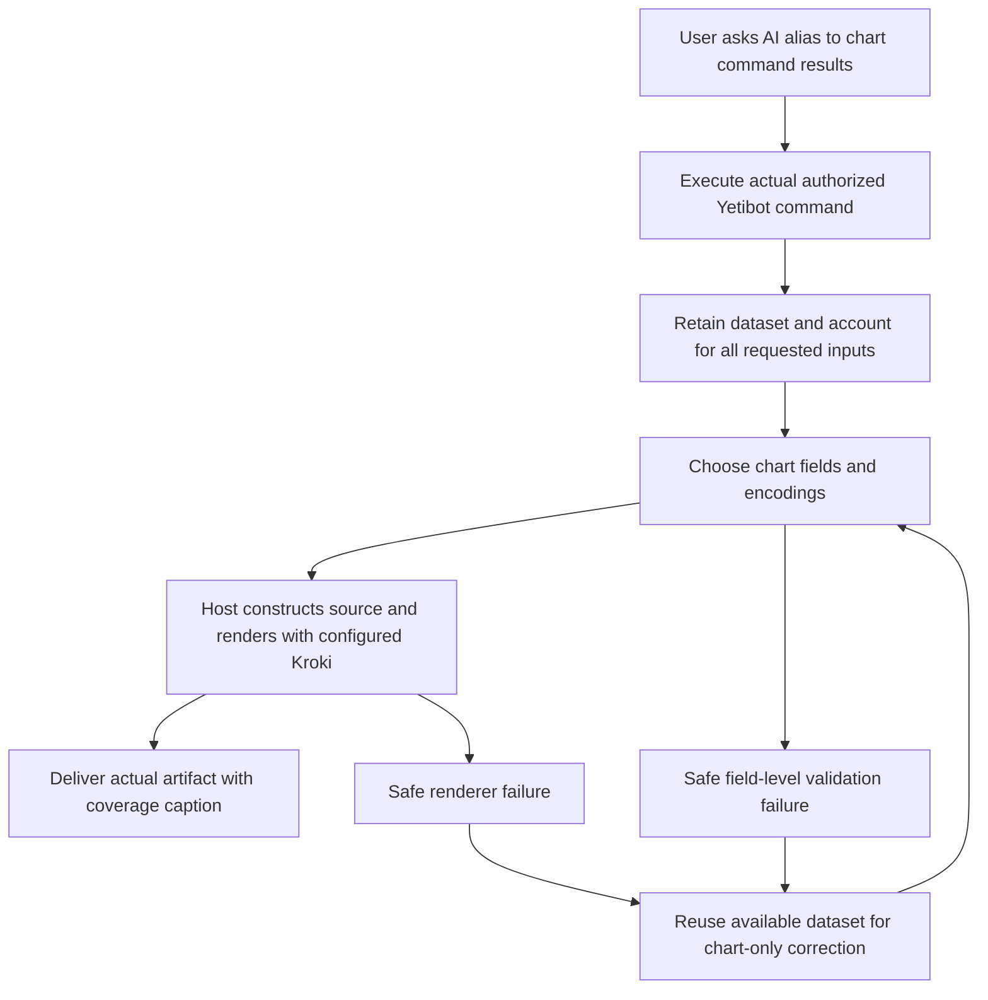
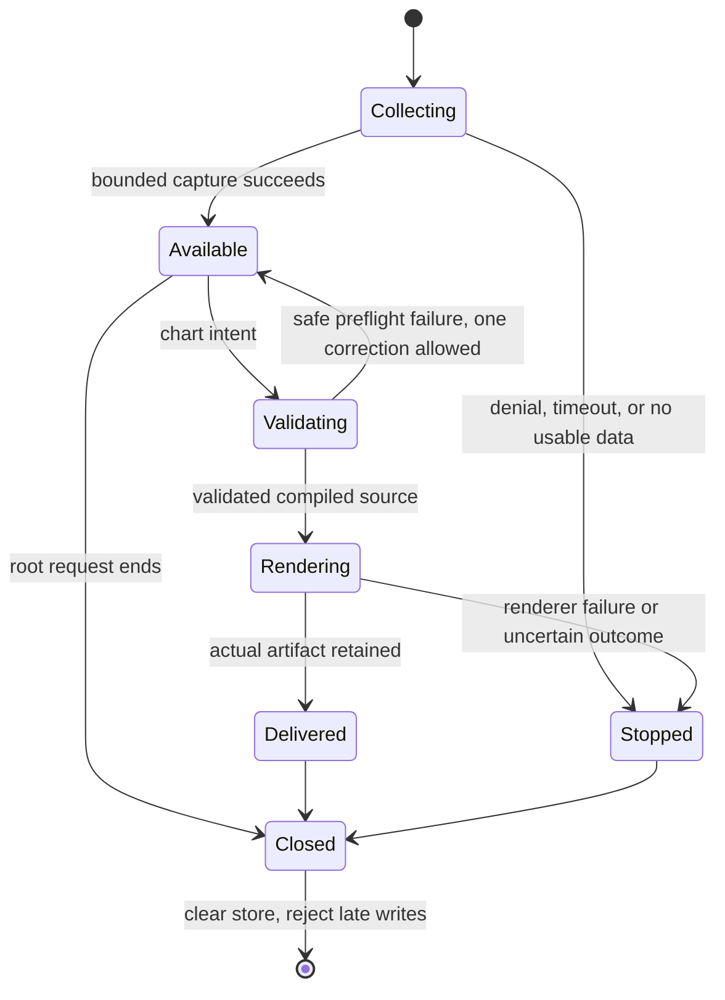

# AI Command-to-Chart Workflow - Plan

## Goal Capsule

- **Objective:** A user can ask their configured AI alias to execute Yetibot commands and turn their complete results into an appropriate chart without a multi-minute sequence of unnecessary discovery and narration.
- **Means:** Actual Yetibot command execution, host-retained datasets, and data-oriented visualization through Kroki.
- **Product authority:** The operator's weather/finance feedback and the two explicit command-authority and public-sharing choices recorded below. Other design choices are recommendations supporting that request, not independently user-approved decisions.
- **Execution profile:** One app-only PR, with three isolated component lanes followed by one integration writer. The lane board below governs ownership before fanout.
- **Shipping owner:** The parent owns publication, exact-head full CI, merge, release, and Benson deployment. This local stage produces the committed plan only; component and integration stages implement it.
- **Open blockers:** None. Runtime/provider latency is deferred qualification, not evidence of correctness; historical balances follow KTD5 rather than inferred transaction arithmetic.

---

## Product Contract

### Summary

Give the AI a real Yetibot command execution capability and a charting workflow that preserves complete command results.
The model chooses the visualization; the host prepares the chart data, renders it through Kroki, and delivers the actual artifact.

### Problem Frame

An operator requested a weather diagram through an AI alias. The result took 112.3 seconds, used a flowchart, and represented only three locations although the current location alias contained five.
The visible trace showed alias/history inspection followed by three weather calls, rather than execution of the requested alias.
The response also contained an empty Markdown image placeholder and an orphaned artifact heading.

A separate Wise visualization request took approximately 39 seconds and rejected the render tool call before execution.
Its four completed tools accounted for approximately 3.9 seconds; the remaining time cannot be assigned to a specific cause from the screenshots alone.
The error view exposed an opaque nested object instead of a useful argument-level explanation.
The screenshots do not establish which render argument failed.

These examples expose workflow gaps, not evidence that changing the model or speeding up Kroki alone will solve the problem.
The operator's target `gemma` alias is `ai --provider cloudflare --model @cf/google/gemma-4-26b-a4b-it`.

### Key Decisions

- **Automatic caller-authorized commands.** Governs R1-R3. (session-settled: user-directed — chosen over automatic reads with confirmation for writes/unknown effects, and over an explicit command allowlist: the operator selected all caller-authorized commands automatically.)
- **Automatic public chart rendering and delivery.** Governs R17. (session-settled: user-directed — chosen over private rendering/restricted delivery and over per-share consent: the operator selected the current public path after disclosure that embedded financial data reaches public Kroki and outputs have public temporary bearer URLs.)
- **One general command-to-chart workflow.** Governs R4-R10. This is the recommended alternative to adding one-off weather and finance chart tools or relying on prompting alone.
- **Host-generated statistical chart specifications.** Governs R6, R9, R11. Vega-Lite through Kroki is the recommended starting point for data charts, while existing diagram capabilities remain available under R10.

### Requirements

**Command execution and authority**

- R1. The agent can execute ordinary Yetibot commands, aliases, and pipelines through the actual command dispatcher rather than reconstructing their behavior from metadata or history.
- R2. Execution uses the requesting caller's real identity, channel permissions, and active toolset without an additional AI-specific confirmation gate or command allowlist, including for caller-authorized state changes.
- R3. Execution retains existing trust checks and finite execution bounds; alias expansion, command output, nested AI calls, and model-supplied context cannot forge a caller, grant authority, or reset the request's inference budget.

**Complete datasets and useful charts**

- R4. Structured command results remain available as caller-scoped datasets with fields, units, source identity, and freshness; text-only output must not be presented as verified structured observations without validated extraction.
- R5. Collection and charting account for every requested input and disclose failures, limits, sampling, or aggregation rather than silently presenting a subset as complete.
- R6. The agent chooses visual encodings from the data and the user's goal, using quantitative charts for comparisons and trends rather than defaulting to relationship diagrams.
- R7. Charts label their fields, units, locations or series, and applicable time range consistently; calculations must not mix incompatible currencies or units.
- R8. Financial charts use complete data for the requested scope, and historical balance series require an authoritative baseline or running-balance source rather than guesses from a truncated transaction list.
- R9. For data charts, the model specifies the intended fields and encodings while the host constructs the renderer specification from the retained dataset, without requiring the model to copy every value into source.
- R10. Existing raw Kroki rendering, dynamic engine discovery, command pipelines/fences, rich artifact delivery, and safety limits remain available for custom diagrams and advanced uses.

**Latency and progress**

- R11. The normal known-alias-to-simple-chart path requires no more than two planning model responses and one successful render, without a mandatory model response after rendering; already supplied pipeline data is reused instead of refetched.
- R12. Independent host-known read operations may run with bounded concurrency, while state-changing or unclassified operations retain order and are not blindly repeated after an uncertain outcome.
- R13. Progress and diagnostics distinguish model time, command/data time, chart preparation, rendering, and delivery, so a slow request can be attributed rather than blamed on the renderer by default.

**Failures, delivery, and operational compatibility**

- R14. A rejected chart call reports the failed stage, whether execution began, and a safe field-level problem and remedy without exposing rejected values, raw source, arbitrary upstream prose, or credentials.
- R15. A chart-only failure does not require rerunning successful collection while its bounded caller-scoped dataset remains available.
- R16. Final delivery uses real host-owned artifacts rather than model-invented links or empty image placeholders.
- R17. Authorized chart requests use the operator-configured renderer and current public temporary artifact path automatically, including financial chart data, while existing credential blocking/redaction and source/MIME protections remain enforced.
- R18. This capability works with the operator's existing AI alias and provider/model settings without silently changing inference budgets, provider defaults, permissions, updater configuration, or unrelated functionality.

### Key Flow

- F1. A user asks their AI alias to chart a command's results.
  - **Trigger:** A request such as asking `gemma` to run `temps` and visualize all locations.
  - **Steps:** The agent invokes the real command under R1-R3; the host retains and accounts for results under R4-R5; the agent selects a chart under R6-R9; the host renders and delivers under R11-R18.
  - **Outcome:** A useful chart and concise caption with honest coverage, or an actionable explanation that preserves successful work.



The correction loop is subject to R3 and R12; it is not an unbounded retry policy.
Under R14-R16, the primary error message explains what failed before expandable technical details, and the caption carries coverage rather than duplicating a long table.

### Acceptance Examples

- AE1. **Covers R1, R4-R7, R9, R11, R16, R18.** Given a `temps` alias whose current location source contains five entries, a request through the existing `gemma` alias executes that alias and produces a temperature comparison with all five locations, consistent units, and readable labels. It does not substitute an older three-location history sample or require the user to choose a chart engine.
- AE2. **Covers R4-R5, R14.** If one of five location lookups fails, the response identifies the missing location and reports four successful results out of five. Any partial chart is clearly partial rather than labeled complete.
- AE3. **Covers R2-R3, R12.** A permitted state-changing command runs without a new AI confirmation prompt; a command rejected by the caller's existing permissions remains rejected, including when reached through an alias. An uncertain state-changing outcome is not automatically replayed.
- AE4. **Covers R4-R5, R8.** If a two-week Wise period contains more than 20 transactions, the chart uses the complete requested scope or explicitly explains the coverage limitation. It does not treat the native tool's first 20 rows as the full period.
- AE5. **Covers R7-R8, R14.** A historical balance line uses an authoritative baseline or running balances for the same currency and time scope. If those are unavailable, the response explains that limitation instead of drawing an invented balance history.
- AE6. **Covers R3, R14-R15.** A malformed chart argument is rejected before renderer submission with a safe field-level reason. A correction can reuse the available dataset without rerunning the source command, and any additional work remains inside the request budget.
- AE7. **Covers R9-R11, R13, R16.** A successful five-location run produces the artifact within the normal planning/render call counts and reports stage timings. No empty Markdown image, orphaned artifact heading, or extra final narration request is needed.
- AE8. **Covers R3, R17-R18.** A requested financial chart follows the selected public path automatically, but a source containing a configured credential is still blocked without disclosing that credential. The sharing choice does not alter unrelated operator settings.

### Scope Boundaries

- This is an AI workflow improvement, not a new OS shell tool, plugin-system rewrite, or separate MCP server.
- Private rendering infrastructure and authenticated artifact delivery are not part of this scope, per the settled choice governing R17.
- No new provider/model selection, automatic paid fallback, or lower inference budget is required to claim a performance improvement.
- General arbitrary-program execution, unrestricted recursion, and new approval-bypass mechanisms are not implied by R1-R3.
- A separate interactive chart editor, dashboard product, permanent dataset archive, and organization-wide command permission redesign are deferred.
- A fixed end-to-end latency guarantee is not claimed before measurement; R11 and R13 define the initial measurable workflow targets.

### Risks and Qualification

Automatic state-changing execution increases the consequences of model mistakes and untrusted content; caller authorization is not proof that every permitted action matches the user's intent.
This is a consequence of the settled R2 choice, not a new confirmation requirement.

The R17 path exposes chart values to the configured public renderer and chart outputs to anyone holding their temporary URLs.
Retained datasets still require caller scoping under R4; public chart delivery does not make complete raw command outputs or credentials public diagnostics.

Existing screenshots and source inspection establish workflow gaps, but not the exact finance validation cause or a measured breakdown of the 112.3-second weather request.
Synthetic/public datasets and scripted model turns can qualify correctness and call counts without paid inference.
Real provider latency and natural Discord delivery require separate live qualification, and no live paid inference was performed for this investigation.

### Outstanding Questions

All planning-owned questions are resolved by KTD1-KTD8 below.
Deferred qualification: measure the configured provider's planning time and natural chat delivery separately from host work; no paid inference, real financial-account request, production access, or SSH is authorized by this plan.
Exact renderer availability and real-provider latency are not claimed from synthetic tests.

### Sources and Research

- Operator-provided weather and finance screenshots, inspected locally and not copied into this repository. The Problem Frame records their relevant observations without account values.
- `src/yetibot/models/ai_alias_tools.clj` and `src/yetibot/models/ai_util_tools.clj`: metadata/read helpers do not provide general command dispatch.
- `src/yetibot/models/ai_tools.clj` and `src/yetibot/models/ai_native_tools.clj`: tool availability, argument preflight, sequential execution, and bounded request handling.
- `src/yetibot/models/ai_tool_trace.clj`: safe authored failure reasons and bounded public error projection currently lack useful field-specific validation detail.
- `src/yetibot/models/ai_weather_tools.clj` and `src/yetibot/commands/weather.clj`: existing typed weather data and command results.
- `src/yetibot/models/ai_wise_tools.clj` and `src/yetibot/api/wise.clj`: read-only account policy, maximum 20 exposed transaction rows, `has-more`, and no current paging argument.
- `src/yetibot/models/ai_kroki_tools.clj`, `doc/KROKI.md`, and `doc/AI.md`: rendering validation, host-owned output retention, public temporary artifacts, and existing toolset constraints.
- [Kroki documentation](https://docs.kroki.io/kroki/): statistical visualization engines, including Vega and Vega-Lite, in addition to relationship-diagram engines. The published plugin's `client/validate-render!` and `render!` own the current source/format/MIME/storage contract.
- [Wise balance-statement reference](https://docs.wise.com/api-reference/balance-statement): the current published reference uses `/2026Q4`, whole-interval JSON statements, COMPACT transaction rows, optional `runningBalance`, and `endOfStatementBalance`. It documents UTC interval bounds and an SCA-protected endpoint, not cursor paging. This supports KTD5's reuse of the already fetched statement and refusal to invent an opening/daily series; it does not qualify any real account or relax existing identity validation.

---

## Planning Contract

**Product Contract preservation:** Product Contract unchanged; the former planning questions are resolved below without changing R1-R18, F1, AE1-AE8, or either session-settled choice.

### Evidence and implementation boundary

- The baseline is refreshed `origin/master` at `f750377`. `project.clj` already pins genuine published core `20261111.163113.0605945` and Kroki `20261111.164625.6559feb`; no dependency change or sibling-repository edit is planned.
- `handler/handle-parsed-expr` takes four arguments: chat source, real user, Yetibot user, parsed tree. Its result contains `:value`, `:data`, `:data-collection`, and authenticated `:public-result`. It does not dispatch a chat reply. Capture here, not from formatted history or only `record-and-run-raw`'s display value.
- Core aliases use `record-and-run-raw` with `:retain-pipeline? true`. The existing `test/yetibot/test/integration/alias_render_data.clj` runs the actual `temps -> locs | xargs quicktemp | sort` chain and already asserts five aligned raw records and five reviewed weather companions. Reuse that behavior; do not repair it by replacing the alias with individual model-selected lookups.
- Core `public-result/projection` authenticates a process-local metadata marker. `public-result/*capture*` exposes approved fields/existence flags only, not raw data. Neither JSON metadata nor a map with `result/public-data` can manufacture review.
- `ai-tools/run-tools` preflights a whole batch, executes sequentially, rejects repeated actions, and normally sends another model request after every successful batch. `with-kroki-results` already retains actual artifacts after answer omission/failure. Add a terminal data-chart path without changing the existing raw Kroki continuation path.
- `api/wise` already downloads and validates the whole statement per authorized balance before applying its 1-20-row display cap. `summary` totals use all those rows. The missing seam is complete retained data, not a fictional paging API. Preserve its query identity, account pinning, currency, time range, limits, fixed endpoint, and credential handling.
- Single-pass behavior trace: adapter provenance enters through `ai-execution/with-adapter-event`; actor/toolset checks occur before native calls; real parser/interpreter/hooks enforce command permissions; dataset capture is request-local; the compiler consumes records, not rendered text; the plugin owns rendering/storage; the outer AI result owns delivery. Failure at any stage must not replay earlier effects.

### Key Technical Decisions

- KTD1. **Dispatch one literal Yetibot expression through the real handler.** The new command executor parses model-supplied command text, then calls the four-argument handler with host-held identity and source; an inactive-by-default Hooke wrapper captures completed outer and nested expression results. This preserves aliases, pipeline companions, command guards, and R1-R3 without creating a shell or reconstructing a command from history. The root call does not invoke `handle-raw`, `dispatch-command-response`, or history replay. Automatic writes follow R2's settled decision; effects are not inferred from read-only hints.
- KTD2. **Retain bounded data only for the root request.** New dataset storage is an explicitly passed request-owned store, bound by the integrator, never a global registry. It holds at most eight datasets and 2 MiB of serialized retained data in aggregate, at most 10,000 rows and 64 fields per dataset, JSON depth at most 12, finite numbers, and bounded realization of lazy sequences. Refuse an oversized dataset with honest coverage, not a silent prefix. Opaque IDs resolve only in that live store and for its host-held actor/source. Close and clear it in the root completion's `finally`; late callbacks cannot repopulate it. This is the smallest storage satisfying R4/R15, not a cross-message archive.
- KTD3. **Use data handles plus a small declarative chart contract.** The model receives dataset ID, safe source/freshness/coverage, field descriptors, and at most five redacted preview rows, never a requirement to copy the dataset into chart source. A pure compiler receives an already resolved dataset and a chart intent, validates types/units, selects the requested fields from every retained row, and creates inline Vega-Lite JSON. There are no external data URLs, expressions, arbitrary transforms, template evaluation, or model-supplied values in this interface. Existing `kroki_render` remains the unrestricted-engine advanced path under R10.
- KTD4. **Successful data-chart rendering is terminal for that tool batch.** For the normal F1 path, planning response one invokes `command`, response two invokes `chart`; the host compiles, renders once, and returns a concise coverage caption plus the actual retained artifact without another planning response. Supplied structured pipeline input is stored before the first response, allowing direct `chart`. Require `chart` to be the only call in its batch so terminal success cannot drop other requested effects. Raw Kroki tools and non-chart general AI requests keep their current loop. A known validation failure can receive one bounded chart-only correction response using the same dataset; no collection replay, no automatic renderer retry, and no retry after an uncertain render/delivery outcome. The <=2-response target applies to a valid simple path, not an unsuccessful correction path.
- KTD5. **Capture complete Wise statement data before display truncation.** Add an optional host-only `api.wise/*dataset-observer*` callback, nil outside a capture. `query!` emits one normalized full-data envelope only after all existing identity/scope validations succeed, while returning the same public command/native result shape and row limits as before. Reuse the already downloaded rows, with exact decimal strings and explicit numeric/unit descriptors. For transaction charts retain all statement rows; for summary retain full-period totals; for balance retain the current balance snapshot. Do not refetch or invent pages. Retain an optional per-transaction `runningBalance` only when it is validated against the same balance/currency and present for the entire selected series. Otherwise mark historical-balance availability false and explain the limitation; never derive it from today's balance, subtract a truncated list, double-subtract fees, or label internal moves as external income/spending. A running-balance series is observed statement points, not an invented daily or opening balance. No additional baseline endpoint is required to ship useful transaction/current-balance charts under R8.
- KTD6. **Keep authority and inherited execution state outside model data.** The integrator creates root request state once in `ai-execution`, holding the original event/actor, active toolset, effective generation ceiling, remaining host-call allowance, dataset store, cancellation/closed state, and command-capture context. The command module accepts this via host arguments/callbacks, not JSON. Recheck source/actor and toolset at dispatch. Nested command-driven `ai`, `grok`, `cf`, aliases, and tool loops inherit the same host-call counter and generation cap, may narrow but never widen toolset/budgets, and cannot establish a fresh direct-control request. Charge a nested command-driven inference entry before sending it; ordinary native child inference is already charged by its host call and must not be charged twice. Root planning responses retain their current accounting. Keep the built-in 32768/20 defaults and 262144/128 ceilings unchanged. Retain the normal direct-source restrictions on `ai default`, limits, approvals, and updater/admin commands.
- KTD7. **Diagnostics are authored, field-level, and non-executing.** Lane 3 adds a safe problem DTO and diagnosis after native preflight rejects, not a second full JSON Schema execution framework. Expose only host-known field paths, fixed problem codes, and static remedies; redact unknown keys as a literal wildcard. Never publish rejected values, source, command text, upstream prose, credentials, or dataset IDs in diagnostics. Preserve whole-batch rejection before any call begins. Semantic compiler/capture failures can return the same DTO to the integrator. A known field explanation must survive both the ordinary failure summary and the unchanged frozen error-viewer bounds.
- KTD8. **Preserve ordinary execution and public-output protections.** Native batches remain ordered; do not add speculative read classification or new parallel execution. Existing explicitly requested core `xargs` behavior is unchanged, not an excuse to parallelize arbitrary model calls. Capture raw command data privately without marking it reviewed. Use existing redaction and sensitive-field rules for model previews; block credential-bearing chart submissions even under R17. Render through the current `ai-kroki-tools`/published client adapter and retain its authenticated artifact. The host caption and artifact, not model Markdown, own final output. Do not add a privacy consent gate or replacement artifact service (R17's settled decision).

### High-Level Technical Design

```mermaid
sequenceDiagram
  participant U as Chat caller
  participant A as Root AI orchestration
  participant C as Real command executor
  participant D as Request dataset store
  participant V as Pure chart compiler
  participant K as Existing Kroki adapter
  U->>A: Existing AI alias and chart request
  A->>C: Response 1 command with host context
  C->>C: Parser, four-arg handler, aliases and normal guards
  C->>D: Raw/reviewed capture and source coverage
  D-->>A: Handle, fields, coverage, bounded preview
  A->>V: Response 2 chart intent and resolved data
  V->>K: Host-built Vega-Lite source
  K-->>A: Authenticated retained artifact or safe failure
  A-->>U: Host caption and real artifact; no third response
```



### Component contracts and data flow

These names and shapes are the lane handoff contract, not new public config.
The integrator owns adapters between them and any native MCP-shaped result.
No component may require another lane's not-yet-present module in its pure tests.

**Command executor: `yetibot.models.ai-command-tools` (new).**

- `arguments!` accepts a native-style config/operation/argument map and validates only operation `command` with one required string key `command` (1-4096 characters, one parsed expression, optional leading configured chat prefix). No identity, toolset, budget, URL, or options map is accepted from the model. A parsed pipeline and aliases are valid, not shell syntax. The ordinary dispatcher determines command availability.
- `execute!` accepts command text first and a host context second, containing `:chat-source`, `:user`, `:yetibot-user`, `:actor`, `:toolset`, optional `:pipeline-input` companion, and a host-owned `:before-expression!` callback. It returns a host-only capture map with `:status` (`:success`, `:error`, or `:unknown`), fully bounded outer `:pipeline` keys `:value/:data/:data-collection/:public-result`, `:elapsed-ms`, safe `:problems`, and `:expressions` needed for coverage. Each expression entry has `:ordinal`, optional `:parent-ordinal`, original host-only `:tree`, `:status`, `:pipeline`, and `:elapsed-ms`. Private capture is limited to 2 MiB across all entries; on overflow report capture unavailable without claiming the underlying command did not execute. It does not store a dataset or return public-review metadata for raw data.
- Install a single pass-through Hooke wrapper around `handler/handle-parsed-expr`; activate it only within this executor's dynamic capture binding. Chain existing hooks instead of replacing them, invoke the callback exactly once with all four arguments, and realize bounded companions before leaving the scope. Preserve the process-local reviewed marker by using `public/projection`, never JSON roundtripping provenance. Associate nested observations with the root invocation and discard intermediate catalogs as final data candidates.
- Preserve the existing five-second expression evaluation bound (`handler/expr-eval-timeout-ms`) for command execution, with binding-conveying work. Cancel/interrupt on timeout, close capture admission, and return unknown if dispatch began: cancellation is not proof a write stopped. Bound nested expression entries at 256 per command invocation so recursive aliases cannot outrun that deadline. No timeout, error, or uncertain write is automatically replayed.
- Expose no extra command gate or read-only allowlist. Normal administrator, enabled-command/category, Wise source, and direct-control checks run through core hooks. A model can request a write; it cannot become the administrator or original adapter event.

**Dataset storage: `yetibot.models.ai-datasets` (new).**

- Functions `create-store`, `retain!`, `lookup!`, `describe`, and `close!` own KTD2. They accept explicit stores and host owner identity. Keep dependencies to existing libraries and privacy utilities, not command/chart/native registration modules.
- `retain!` accepts a host envelope with `:rows` (vector of row maps), `:fields` (descriptor vector), `:source`, `:captured-at`, and `:coverage`. Snapshot keyword row keys to string spellings and reject collisions; the stored/compiler-facing rows are string-keyed JSON data. `:captured-at` is the host collection time in ISO-8601, not a model-provided freshness claim. It returns an opaque `:dataset-id` and bounded descriptor, never all values. It validates/snapshots the entire accepted envelope before mutation; failure leaves prior datasets reusable. `describe` must fit 12 KiB UTF-8 with field names/paths bounded by the envelope limits; omit or shorten preview cells explicitly to fit, never shorten the retained rows. If metadata itself cannot fit, reject descriptively rather than produce a broken/truncated JSON tool reply.
- Descriptor fields: `:name` is a string of 1-64 characters, `:path` is a vector of at most 12 string keys of at most 128 characters each, `:type` is `:nominal`, `:quantitative`, or `:temporal`, optional `:unit` is an authoritative string, optional `:unit-field` identifies a currency/unit column, and optional `:semantic` distinguishes `:transaction-amount`, `:running-balance`, or `:current-balance`. Descriptors are generated/checked from the retained rows or known host source metadata, not trusted merely because a result map supplied them. Generic numbers are numeric; generic numeric-looking strings stay nominal unless the source explicitly supplies a validated numeric contract.
- Coverage fields: `:status` is `:complete`, `:partial`, or `:unknown`; counts `:requested/:succeeded/:failed` may be absent when unknown; `:row-count` is exact; `:from/:to`, `:has-more`, `:aggregation`, `:limitations`, and safe failed-input labels are optional host facts. Complete means complete for the declared source/request scope, not proof of unlimited upstream history. Never infer requested count from only successful rows or make it model-editable.
- The outer aligned `:data-collection`, then outer `:data`, is the generic structured candidate. Authenticated reviewed companion supplies public units/source and coverage where available. Retain the raw companion privately; do not fall back from a missing reviewed row to marking raw data reviewed. `:value`/text-only results remain usable command output but are not verified observations. Existing pipeline snapshots can be retained directly without command execution.
- Keep capture and normalization adapters outside these storage primitives. The integrator turns weather reviewed `:current` plus units into flat fields, pairs all five nested requested inputs with successes/errors, and uses Wise's observer envelope for complete finance. Missing items stay in coverage even if no data row exists. Unknown generic upstream completeness is explicit rather than falsely promoted to complete.

**Chart compiler: `yetibot.models.ai-charts` (new).**

- `compile-chart` accepts only a resolved envelope from the host plus string-keyed intent: required `kind` (`bar`, `line`, `point`, or `area`), `x` and `y` field names; optional `series` and `title`. No dataset lookup, IO, command execution, identity, raw Vega, URLs, copied rows, or model inference. Integrator strips/resolves the native tool's additional required `dataset_id` before calling it.
- Return either `{:ok? true, :request ..., :caption ..., :coverage ...}` or `{:ok? false, :problem ...}`. `:request` is the existing plugin-shaped map with `:type "vegalite"`, inline JSON `:source`, and default `:format "auto"`. Model text is never artifact proof. `render-chart!` accepts a render callback and that compiled result, invokes the callback once with `:request` only on success, and returns its actual result with host caption/coverage; it must not require another new module or invent an artifact.
- Validate names against descriptors, require finite quantitative `y`, temporal/ordered `x` for trends, and preserve every row including null/missing measurements with disclosed gaps. Build host labels from field/unit/source metadata. Financial titles and axes derive from the selected field's host semantics; a model title cannot relabel transaction amounts or current snapshots as historical balances. Encode values as JSON literals, not executable expressions; reject incompatible values and oversize source before render. Respect the plugin's current 262144-byte source bound rather than raising it. Do not silently sample or aggregate to fit.
- Different currencies/units for a quantitative value must use separate facets with independent scales in the single Vega-Lite render, or fail clearly when the source lacks sufficient unit metadata. Color alone does not make unlike currency amounts comparable. No unrequested currency conversion. The caption distinguishes transaction activity, current balances, and statement running-balance points using host semantics and KTD5.
- Use static `vegalite` as the data-chart encoding, not a global engine allowlist. Kroki's docs list Vega-Lite; the existing client still handles actual service/type/format errors and dynamic discovery. Raw diagram functionality remains unchanged.

**Financial observer: `yetibot.api.wise` (existing, lane 2).**

- `*dataset-observer*` receives a normalized envelope with KTD2-compatible rows/fields, authorized account alias (no profile/balance IDs), source `wise`, `:captured-at`, exact requested `:from/:to`, coverage, and optional validated historical-balance availability. A host-generated `:series-field` identifies separate authorized balances with request-local labels such as `USD balance 1`; do not collapse distinct same-currency balances into a single running-balance line. The compiler preserves this series grouping even when the model omits `series`. Binding and storage are integrator-owned; no dependency on `ai-datasets` or `ai-command-tools`.
- Emit after all selected balances/statements have succeeded, before display `take`. The callback receives no token, bank details, account holder, raw transport body, or unrelated account. Failure to retain a chart dataset must not silently turn a caller-authorized completed command into a second financial request. A callback retention error is reported separately by the integrator; the underlying command result/effects remain real.
- Preserve query `profileId`, currency, interval bounds, optional `accountId` checks, fixed request paths from pinned metadata, existing malformed/duplicate identity failures, and default native/CLI response limits. Do not weaken fixtures to make new captures pass. Optional running-balance validation is additive; absent running balances do not invalidate otherwise valid transaction requests.

**Safe problem DTO: `ai-tool-trace` (existing, lane 3).**

- Shape: `:stage` from `:arguments/:collection/:chart/:render/:delivery`, `:field` from host-authored schema paths, `:code` from a closed vocabulary, `:remedy` from a static host mapping, and `:execution-began` boolean. A maximum of three problems is sufficient; unknown facts are not replaced with guessed causes.
- Codes cover required/type/enum/range/size/unknown-field, unavailable-field/incompatible-unit/incomplete-scope, credential-input, and unknown-outcome. Dynamic object keys use a fixed path such as `options.*`; unknown fields use `*`, never the rejected spelling. Static schema paths are admitted only from authored native schema metadata, not arbitrary remote schemas or model claims.
- `argument-problem` derives a safe structural problem from a rejected native argument map and its authored schema; otherwise return a static root-level fallback. The existing native semantic validator remains authoritative. `sanitize-problem` checks authored stage/path/code/remedy and bounds; lane 1/2 pure tests use the DTO shape without importing this not-yet-changed helper. Integrator applies it at boundaries.
- `parse-call` adds the sanitized diagnostic to the specific rejected trace row before rethrowing whole-batch failure. Existing `trace/fail!` callers remain compatible. `public-errors`, `public-report`, failure summaries, and typed progress retain the useful field/stage/execution fact without expanding public storage ceilings. Native argument preflight rejection always says execution did not begin.

### Integration-only adapters and terminal behavior

The integration writer exclusively owns the following shared changes after component handoffs:

1. Register `command` and `chart` in `ai-native-tools` and `ai-toolsets`, using the existing trusted-native availability pattern. Legacy trusted general search defaults gain these capabilities; explicit `:native-tools` selections stay authoritative, including empty selections and `--no-tools`. Do not expose command execution in GitHub-specific toolsets that do not permit it. `chart` availability also requires the existing plugin client; no operator config rewrite.
2. In `ai-tools/complete`, create/close the root request store and inherited counter once, attach host callbacks to native tools, and capture optional supplied pipeline data. Bind Wise's observer for both the command adapter and existing native `wise` calls; retain each full envelope once and add the bounded handle/descriptor to the model result without removing existing limited fields. In the command adapter invoke lane 1's actual dispatcher, normalize captured data, and reuse that handle when the final scope matches. A source-observer dataset does not override an explicit downstream pipeline selection; retain its distinct source scope separately when alignment with final transformed output cannot be proven. A successful write without a dataset is still a successful command; never claim a chart was made.
3. In the chart adapter, resolve the caller-owned ID, compile with lane 2, apply existing credential/source checks via the existing Kroki adapter, and retain the returned actual artifact/caption. Charge the normal tool attempt once. Successful `chart` sets an internal host-only terminal record; `execute-batch`/`run-tools` return it with actual costs, trace and tool counts instead of sending another model request. A model JSON key or remote tool's `terminal`/`artifacts` payload cannot set it. Failed compilation retains the store and can use KTD4's one correction. For a sole `chart` call's known preflight rejection, project the sanitized nonexecution receipt back to the model for that same one correction allowance instead of ending the request immediately; all other whole-batch rejection behavior stays unchanged. Failed correction terminates with the host's explanation, not another retry loop.
4. `with-kroki-results` deduplicates terminal artifacts and does not append an empty/orphaned heading. On the new terminal chart path, discard pre-tool model narration/image placeholders, use host caption and actual artifact only, and keep source/raw rows out of public execution data. On existing general/raw Kroki paths, preserve current answer retention and failure behavior.
5. Add inherited request context in `util/ai_execution.clj`; clamp nested completion budgets and policy in `commands/ai.clj`, `commands/cf.clj`, and the shared tool loop. Preserve actual `*event*` and real user bindings, including retaining the real `yetibot-user` argument at the adapter boundary for the command executor; never fabricate a bot/caller identity when a test or caller lacks it. A nested source cannot set direct-control provenance. `util/ai_status.clj` bypasses child status/caption ownership during captured command execution; `commands/grok.clj` returns nested results rather than starting its standalone live-answer publisher; continuation remembering does not open a new child conversation. Intentional effects of ordinary commands still execute; only duplicate AI answer/status ownership is suppressed.
6. Prompt guidance selects the actual named alias immediately and recommends the two-step data path, without routing every general question into charts. Keep greetings, no-tool/text-only providers, MCP search, structured inference, GitHub proposals, provider/model choice, defaults, budgets, and raw Kroki compatible.
7. Record monotonic elapsed milliseconds for planning responses, command/data collection, chart preparation, render, and terminal handoff using closed stage names only. The `:stage-timings` DTO contains at most five entries with `:stage` from `:planning/:collection/:preparation/:render/:handoff` and nonnegative integer `:elapsed-ms` capped at 300000; repeated planning time is aggregated, with an independent actual `:planning-responses` count. Expose bounded stage timings in the reviewed execution DTO and typed progress; preserve existing tool ordinals and actual attempt accounting. A handoff timer is not adapter delivery confirmation. The integration writer owns timing production/transport (`ai_tools`, status selection); lane 3 owns safe projection in trace/progress.

### Lane board and authority before fanout

Component owners execute serially on the clean `feat/ai-command-charts` branch, starting at the committed plan base, with exactly one mutation-capable worker at a time.
The native managed-worktree helper failed with `spawn wt EACCES` before any component worker started; no alternate coding CLI or host-tool installation is used.
Sibling core/plugin repositories remain read-only evidence; no source overlays or local dependency publication count as artifact qualification.
The parent verifies each committed handoff and clean checkout before the next component starts.

| Lane | Isolation and exclusive ownership | Authority | Gate before handoff | Handoff |
|---|---|---|---|---|
| L1 / U1 | Serial app feature branch; NEW `src/yetibot/models/ai_command_tools.clj`, `src/yetibot/models/ai_datasets.clj`; NEW `test/yetibot/test/models/ai_command_tools.clj`, `test/yetibot/test/models/ai_datasets.clj`, `test/yetibot/test/integration/ai_command_capture.clj` only | Implement KTD1/KTD2 primitives and their tests; no shared file edits or registration | Focused command/dataset/real-alias capture tests; inactive hook is pass-through; genuine dependencies | Commit plus exported functions, capture/envelope examples, bounds, commands/results, residual risks |
| L2 / U2 | Serial app feature branch; NEW `src/yetibot/models/ai_charts.clj`, NEW `test/yetibot/test/models/ai_charts.clj`, NEW `test/yetibot/test/api/wise_dataset.clj`; existing `src/yetibot/api/wise.clj` and `test/yetibot/test/commands/wise.clj`, `test/yetibot/test/models/ai_wise_tools.clj` only | Pure compiler/render-callback seam and essential complete financial capture; preserve native/CLI limits and identity checks | Pure compiler plus scripted Wise transport fixtures, existing Wise regressions; no account requests | Commit plus compiler/problem DTO examples, observer envelope, API fixture provenance, commands/results |
| L3 / U3 | Serial app feature branch; existing `src/yetibot/models/ai_tools.clj` ONLY preflight/diagnostic propagation seams; `src/yetibot/models/ai_tool_trace.clj`, `src/yetibot/models/ai_progress.clj`; authored validation-detail changes only in `src/yetibot/models/ai_kroki_tools.clj`; existing corresponding tests `test/yetibot/test/models/ai_tools.clj`, `ai_tool_trace.clj`, `ai_progress.clj`, `ai_tools_progress.clj` | Field-level safe diagnostics; no execution loop, terminal path, budgets, registration, docs, or new component imports | Malformed arguments do not dispatch; privacy/bounds/frozen viewer tests; current outcomes and accounting unchanged | Commit plus DTO/sanitizer/path contract, exact `ai_tools` changed seams, commands/results |
| Integration / U4 | App main feature branch after components; all native registration/toolset/orchestration/terminal adapters; `commands/ai.clj`, `commands/cf.clj`, `commands/grok.clj`, `util/ai_execution.clj`, `util/ai_status.clj`; shared docs and final integration tests | Sole adapter and shared-file writer after handoffs, including additional `ai_tools.clj` execution changes; no concurrent ownership with L3 | Consume each reviewed lane commit, then scripted two-response/one-render end-to-end and regression gates | One coherent app diff with tests, exact tree, published dependency evidence, no remaining component blockers |
| Parent / shipping | Publication, CI, merge, release and deployment only | Own all remote/production actions; local lanes do not use SSH or deploy | Independent review and exact-head PR CI full suite once | Release/deployment evidence outside local planning/component claims |

L1-L3 remain independently testable: their tests construct ordinary envelope/problem maps and inject existing boundaries, never import another lane's future module.
They run serially because managed-worktree allocation is unavailable; L3 completes before the integration writer edits the tool loop.
Do not expand a lane's file list for convenience; cross-lane adapters, shared fixtures/docs, and final integration coverage belong to U4.
Each handoff names test DB isolation and any untested runtime assumption.

### Assumptions and deliberately unbuilt mechanisms

- Unvalidated operational bet: Vega-Lite is available on the configured renderer. The documented engine is the initial data-chart target; unavailable service/engine returns a truthful render failure, not a hidden engine substitution or invented image.
- Unvalidated operational bet: the existing five-second command bound is adequate for the known alias with healthy services. Tests prove call counts and data integrity, not live weather/provider latency. A timeout is reported as uncertain under KTD1, never shown as complete.
- Request memory is sufficient for the common weather/financial scope under KTD2. Larger results fail with explicit size/coverage limitations; changing those bounds requires evidence, not a silent cap increase.
- No new approval service, command-effect classifier, read-concurrency scheduler, dataset HTTP service, generic extraction model, full JSON Schema engine, or automatic financial baseline reconstruction is built. Existing guards, ordered native execution, literal structured data, and explicit coverage already close this work's actual gaps.
- No feature flag/config migration, paid benchmark harness, dependency update, provider/model-default change, updater change, permissions redesign, or sibling release is needed. A source-level need for a missing core/plugin feature would be an essential cross-repo blocker to report, not permission to widen scope.

---

## Implementation Units

### U1. Actual command capture and request-owned datasets

- **Goal:** Supply real command execution and bounded reusable data primitives, not a native registration/orchestration implementation.
- **Requirements:** R1-R5, R12, R15, R18; F1; KTD1/KTD2 and command/storage contracts above.
- **Dependencies:** Committed plan only. Independent of U2/U3 modules.
- **Files:** L1 ownership row is exhaustive. The new model tests prove bounds/ownership without network; the new integration test proves real parser/alias/raw/reviewed behavior but not provider or Discord transport.
- **Approach:** Implement executor/capture and storage separately; inject host admission callbacks and construct envelopes as fixtures. Follow `util/ai_execution.clj`'s Hooke chaining and `test/support/ai_execution.clj`'s genuine adapter entry. Use existing real alias fixture patterns, not mocked command dispatch.
- **Execution note:** Synthetic tests first. No inference or external financial requests.
- **Test scenarios:**
  1. Covers AE1. Real five-location `temps/locs/quicktemp` hooks return all five raw records and aligned reviewed companions, despite rendered Fahrenheit text and nested sorting. Every weather fixture is called once; no history lookup or chat-response dispatch is used.
  2. Covers AE2. One of the five nested weather commands fails; capture retains the four successful observations plus the failed request/coverage receipt, not an invented fifth row.
  3. Covers AE3. A synthetic non-admin write hook executes automatically once; a real core admin/category guard denies an unauthorized command/alias. Forged event/user/actor fields and direct-control commands do not gain authority.
  4. Invalid syntax/oversize input rejects before dispatch; expression recursion and timeout return truthful status; late captured results cannot revive a closed request. Never retry a timed-out synthetic write.
  5. Dataset ownership rejects another actor/store and expired/closed IDs. Max-count/byte/depth/row/field boundaries, nonfinite/unsupported values, duplicate normalized keys, and lazy sequences fail atomically without changing prior retained data.
  6. Raw numeric data is retained but not labeled reviewed; text-only output remains text. Credential/sensitive-field preview redaction never changes stored numeric observations into falsely verified chart values.
- **Verification:** Actual handler called once per requested expression; inactive hook has no effect; all component tests load using only existing modules and L1 additions.

### U2. Data chart compilation and complete Wise capture

- **Goal:** Compile useful complete-data charts and expose full financial data already read by the guarded API.
- **Requirements:** R4-R10, R14-R17; KTD3/KTD5/KTD8 and compiler/observer contracts.
- **Dependencies:** Committed plan only. No dataset-store or trace implementation import.
- **Files:** L2 ownership row is exhaustive. Compiler tests catch generated spec/labels/coverage, not actual engine availability; observer tests use genuine-shaped scripted Wise responses, not live account qualification.
- **Approach:** Build pure chart compilation and injected single-render seam, then add the nil-by-default Wise observer around the existing validated collection. Do not change native Wise arguments, CLI display limits, request endpoints, or source identity requirements.
- **Execution note:** Start with five-record weather and >20-row financial fixtures; preserve all existing identity rejection assertions.
- **Test scenarios:**
  1. Covers AE1/AE7. Five locations compile to a bar with all five quantitative temperatures and Celsius units; generated JSON uses `data.values` and appropriate encodings, not a flowchart or copied display strings.
  2. Temporal multi-series data produces a line with labels; partial/missing data produces an honest coverage caption and gaps. Empty or nonnumeric datasets fail safely without renderer invocation.
  3. Covers AE4. A statement with 25+ transactions gives the observer all rows and exact scope/count while native/CLI display remains <=20 with `has-more`. One HTTP statement fetch per selected balance; summary uses complete existing totals.
  4. Covers AE5. Current balances are not historical baselines. Missing/partial/wrong-currency running balances cannot produce a claimed historical-balance series; valid full running balances produce only documented statement points. Internal moves and fees are not reinterpreted as spending or double deducted.
  5. Mixed currencies use independently scaled facets or explicit failure, never a combined amount axis. Exact decimal strings remain retained; invalid money/date/unit values reject rather than silently coerce.
  6. Covers AE6/AE8. Invalid fields/kinds/source size, source injection strings, and malicious result keys cannot add external URLs, expressions, authority, or credentials. Field errors contain fixed paths/codes, not rejected values. Compile failure calls render zero times; success calls the injected callback exactly once.
  7. Existing missing/mismatched `profileId`, `accountId`, currency, date range, duplicate metadata, malformed token/config, and unauthorized-user fixtures still reject before emission. A failed source never emits a complete dataset.
- **Verification:** Pure specs are parseable JSON and honor existing client limits; real-shaped fixture transport proves full statement capture without weakening source identity or changing existing result contracts.

### U3. Safe field-level validation diagnostics

- **Goal:** Make preflight failure actionable without disclosing rejected content or changing execution policy.
- **Requirements:** R13/R14/R18; KTD7 and safe problem DTO contract.
- **Dependencies:** Committed plan only; uses existing native schemas and validators.
- **Files:** L3 ownership row is exhaustive. Existing model/progress/frozen-viewer tests prove public diagnostics and rejection accounting, not final chart orchestration.
- **Approach:** Identify safe structural field failures after native rejection, annotate the rejected call, and project authored explanations through existing trace/progress paths. Do not change the batch loop's continuation policy or import future command/compiler modules.
- **Test scenarios:**
  1. Covers AE6. A render argument with wrong `options` type, missing `source`, invalid `format`, oversized source, or an unknown key gets a stage/field/code/remedy with `execution-began false`; the entire batch dispatch count remains zero.
  2. Credential-bearing values, unknown nested keys, Unicode/control/mention strings, arbitrary upstream exception data, and remote schemas cannot enter diagnostic paths/remedies or public output.
  3. An opaque validator failure keeps a truthful root fallback rather than inventing the field that failed. Valid native/MCP calls and existing per-tool argument-size exceptions behave as before.
  4. Three worst-case diagnostics survive actual core frozen error node/text bounds; errors remain failure-first and chronology omission cannot hide the actionable preflight receipt. Attempted/confirmed flags, progress labels, and budgets remain truthful.
- **Verification:** Existing trace/progress tests pass with useful diagnostic additions; commands/results identify only preflight seams changed in `ai_tools.clj` for the later integrator.

### U4. Wire and qualify the complete autonomous workflow

- **Goal:** Deliver F1 through the operator's existing general AI alias using the component contracts, without impairing general AI behavior.
- **Requirements:** R1-R18; F1; AE1-AE8; KTD1-KTD8.
- **Dependencies:** Reviewed U1/U2/U3 commits, all focused component gates, no launch-blocking handoff gap. No concurrent edits with component owners.
- **Files:** Integration ownership row plus `src/yetibot/models/ai_native_tools.clj`, `src/yetibot/models/ai_toolsets.clj`, `src/yetibot/models/ai_tools.clj`; new `test/yetibot/test/integration/ai_command_charts.clj`; existing registration/toolset/command/pipeline/Kroki integration tests as needed; `doc/AI.md`, `doc/KROKI.md`, and this plan only if a factual implementation correction is needed. Shared budget/status/continuation regression tests belong to this writer.
- **Approach:** Implement the integration-only adapters above, then scripted end-to-end tests at the genuine adapter and published client boundaries. Cover nested AI policy/accounting and status ownership before exposing `command` in default trusted tool availability.
- **Execution note:** Use scripted local model turns, actual command hooks, synthetic weather/Wise responses, and stub only transport/storage boundaries. No source-composed dependency paths or paid inference qualify this stage.
- **Test scenarios:**
  1. Covers AE1/AE7. Existing `gemma`-shaped alias runs real `temps`, gets all five locations, and returns a verified chart using exactly two scripted planning responses and one renderer request. Model text may contain an empty image placeholder and omit the URL; final output still has only the host caption and actual artifact, no third response or orphaned heading. Assert the configured provider/model and effective 32768/20 values on wire.
  2. Covers AE2/AE6. One location fails or a chart field is invalid; coverage/diagnostics are explicit. A single chart-only correction reuses the same store, does not rerun collection, stays inside inherited budgets, and cannot recover after an uncertain outcome by replaying effects.
  3. Covers AE3. Authorized synthetic write through an alias executes once with the real user; disabled/admin-only operations remain denied. Recursive `command -> alias -> ai` and `cf` cannot reset budgets, change actor/source, widen active toolset, set global defaults/limits, or obtain original direct-request provenance. Nested AI/grok emits no duplicate status/final reply/continuation, while authorized non-AI command effects retain normal behavior.
  4. Covers AE4/AE5. A complete synthetic two-week statement with >20 rows charts all requested data from one fetch; truncated data without the observer never claims complete. Missing authoritative running balances produces a limitation instead of a fabricated balance line.
  5. Covers AE8. Financial values automatically traverse the configured public render/artifact path with no privacy prompt; configured credentials in any selected field/source block submission and never appear in model tool results, public trace, caption, or artifact metadata.
  6. Piped structured data is reused without refetch, text-only output is not promoted to verified observations, cross-request dataset IDs fail, and closure prevents late writes after cancellation/failure. Explicit native toolsets/empty selections/no-tools and untrusted HTTP callers cannot acquire command/chart authority.
  7. Existing raw Kroki engine discovery/source fences/multiple artifacts/retention-on-provider-failure stay functional. Greetings, text-only providers, MCP search, GitHub staging/approval, native inference, model defaults and command pipelines retain their existing behavior.
- **Verification:** Two-turn/one-render counts and host ownership are hard assertions, not prompt-only expectations. Final reviewed tree passes focused suites and real published-artifact qualification before the parent runs full PR CI once.

---

## Verification Contract

No production code or tests are executed during this planning stage.
The commands below are the focused implementation gates requested by the operator; they are not evidence of already passing tests.
Use the app's normal published dependencies, not sibling source paths or a fabricated local release.

Local runner prefix for all commands: `JAVA_HOME=/opt/homebrew/opt/openjdk@21 JAVA_TOOL_OPTIONS=-Djava.security.manager=allow YETIBOT_DB_URL=<lane-owned-test-postgresql-url> /private/tmp/yetibot-kroki-work/lein with-profile +test`.
Use each lane's own temporary PostgreSQL database or serialize database-using runs; do not run parallel lanes against one mutable database.
Set database credentials locally without logging them.

| Gate | Append to runner prefix | Pass evidence |
|---|---|---|
| L1 focused | `midje yetibot.test.models.ai-command-tools yetibot.test.models.ai-datasets yetibot.test.integration.ai-command-capture` | Bounds/ownership and real five-row alias/raw/reviewed capture, no transport inference |
| L2 focused | `midje yetibot.test.models.ai-charts yetibot.test.api.wise-dataset yetibot.test.commands.wise yetibot.test.models.ai-wise-tools` | Host spec semantics, complete observer, unchanged identity/authorization/display regressions |
| L3 focused | `midje yetibot.test.models.ai-tools yetibot.test.models.ai-tool-trace yetibot.test.models.ai-progress yetibot.test.models.ai-tools-progress` | Safe actionable fields and whole-batch nonexecution; existing accounting/privacy preserved |
| Integration primary | `midje yetibot.test.integration.ai-command-charts yetibot.test.integration.alias-render-data yetibot.test.integration.ai-kroki-tools yetibot.test.integration.ai-kroki-artifact` | Two-response/one-render actual dispatch plus artifact retention and genuine JAR resource/digest checks |
| Adjacent compatibility | `midje yetibot.test.models.ai-toolsets yetibot.test.integration.ai-tools yetibot.test.integration.ai-weather-tools` | Tool availability, legacy behavior, normal source guards; add exact changed command/status namespaces to the run |

The parent alone runs `.github/workflows/test.yml`'s exact final PR-head full suite once, plus its existing CI gate/catalog checks.
Do not repeat `midje :all` locally.
`release:validate` is not a project command and is not introduced.
An optional credential-free public Kroki smoke may validate the generated Vega-Lite document after synthetic gates; label it separately from model/chat qualification.
It must not use real financial values and is not required for pure component test success.
No live paid model test or real Wise account request is permitted.

Evidence handed to the parent includes changed files, tests added/updated, exact focused commands and counts/results, dependency resource qualification, untested runtime assumptions, commit IDs, and a clean/no-staged-files check.
Review is required before integration acceptance and again on the coherent final PR diff.

---

## Definition of Done

- U1-U3 are independently testable with their assigned files only; all handoff contracts are concrete and the integration writer has sole shared-file ownership after handoff.
- U4 proves F1 and AE1-AE8 with scripted turns, genuine caller fixtures, actual alias/command dispatch, full-data capture, typed chart compilation, and host-owned terminal artifacts.
- The valid known-alias path is <=2 planning responses and one successful render; supplied pipeline data avoids collection. Stage timings distinguish planner, command collection, compilation, rendering, and host terminal handoff. Actual adapter delivery timing is reported only where the adapter supplies it, not invented from tool elapsed time.
- Coverage is honest for failures, generic unknown upstream limits, display-truncated finance, size refusals, missing running-balance authority, and incompatible units. Successful collection is not repeated to fix a chart.
- Identity fixtures and statement source checks are not weakened. No raw data is made reviewed, no model data forges terminal success/actor/budgets, and no configured credentials reach public source or diagnostics.
- Existing raw Kroki, general AI/provider/model defaults, 32768/20 generation/tool defaults and ceilings, permissions, updater, configuration, and unrelated files remain intact.
- Abandoned experiments, placeholder code, temporary repository artifacts, staged changes, and cross-lane accidental edits are removed. All intended work is committed with focused evidence; no unrelated user change is included.
- Publication, full exact-head CI, release, deployment, and any natural-chat/live-provider observation remain parent-owned shipping evidence. Local synthetic success is never described as deployed or real-account qualification.
